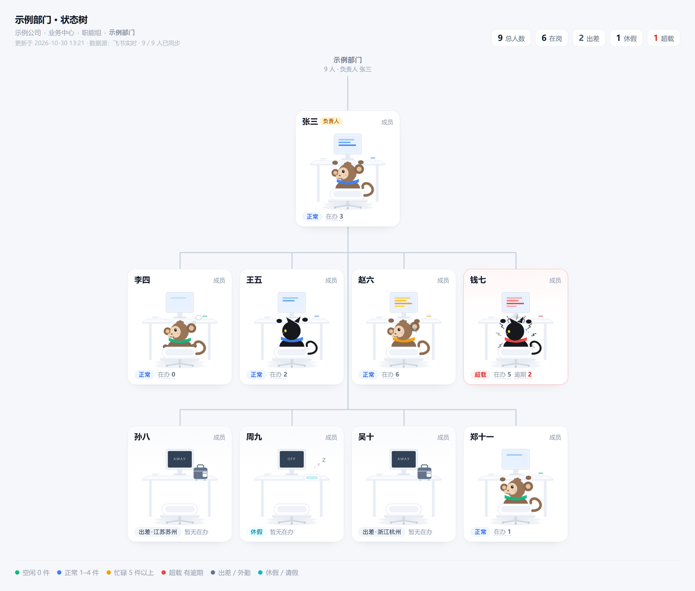

# 团队状态看板（Team Desk Board）

一个跑在内网的小工具，把「谁在不在、手上几件事」做成一面墙。
基于飞书开放平台，零第三方 Python 依赖，单文件 HTTP 服务。

> 本文档与代码均为通用实现，不含任何真实组织的人员、地址或凭据数据。



<sub>样图内的人物、地点、数字全部为构造值（张三、李四……），只用于展示布局与六种状态配色。</sub>

## 它解决什么问题

团队里「谁今天出差、谁休假、谁手上堆了活」通常散在聊天记录里，
问一遍要花几分钟，还没人愿意天天答。这个看板把三类信息汇总到一页：

- **在不在**：从飞书审批自动推导（请假 / 出差 / 外勤）
- **几件事**：从飞书任务、多维表格、群消息、手工录入四个来源合并
- **忙不忙**：按在办数分四档（空闲 / 正常 / 忙碌 / 超载），配不同动画

每天 9:00 往群里推一条汇总，不用任何人手动操作。

## 界面

六种状态各有一个角色形象，全部是手写 SVG，无图片依赖：

| 状态 | 判定 | 表现 |
|---|---|---|
| 空闲 | 在岗且 0 件 | 慢节奏呼吸 |
| 正常 | 1–4 件 | 常规节奏，偶尔左右转头 |
| 忙碌 | ≥5 件 | 节奏加快 + 额头汗滴 |
| 超载 | 有逾期 | 最快节奏 + 汗滴 + 头顶冒烟 + 卡片红边脉冲 |
| 出差 | 审批为出差 | 空椅子 + 行李箱，屏幕显示 AWAY |
| 休假 | 审批为请假 | 空椅子 + 枕头，屏幕显示 OFF |

## 数据流

```
飞书审批 ──┐
飞书任务 ──┤
多维表格 ──┼──→ todos / absences ──→ status 推导 ──→ 看板 + 每日推送
群消息   ──┤
手工录入 ──┘
```

## 快速开始

### 1. 环境

- Python 3.9+（只用标准库）
- 可选：`lark-cli`（多维表格读写、通讯录兜底）

### 2. 配置

```bash
cp config.example.json config.json
```

然后填入飞书应用的 `app_id` / `app_secret`，以及审批定义 code 等。

`config.json` 已在 `.gitignore` 里，不会被提交。

### 3. 启动

```bash
python server.py
```

默认监听 `0.0.0.0:8900`，日志写入 `logs/server.log`。

Windows 下想后台无窗口运行，用 `pythonw.exe server.py` 并注册计划任务（见下文「部署到另一台机器」第 5 步）。

### 4. 登录授权

访问 `/login` 走飞书 OAuth。授权时会在 `scope` 里显式请求
`offline_access task:task:read`——前者用于拿 `refresh_token`（否则 2 小时就要重授权），
后者用于读飞书任务。

想看完整部署流程（建应用、申请权限、计划任务、固定 IP、验收），直接跳到
[部署到另一台机器](#部署到另一台机器windows从零)。

## 部署到另一台机器（Windows，从零）

按「拿到一台空机器」到「同事能打开」的顺序，约 30 分钟。踩过坑的地方都标了出来。

### 0. 前置条件

| 项 | 要求 |
|---|---|
| 系统 | Windows 10/11，能长期开机（看板靠它一直跑） |
| Python | 3.9+，安装时勾 **Add python.exe to PATH**，`python -V` 能出版本 |
| 网络 | 与同事同一内网；本机 IP 需要固定（第 6 步） |
| 飞书 | 有企业自建应用的创建权限 |
| 团队群 | 一个包含全部成员的群——**群成员就是看板名单** |

### 1. 建应用，权限一次申请齐

1. [飞书开放平台](https://open.feishu.cn/app) → 创建企业自建应用
2. 「凭证与基础信息」抄下 **App ID / App Secret**
3. 「权限管理」按下面这张表**一次勾完再提交**——分批提交就要多等几轮审批

| 权限 | 身份 | 用途 |
|---|---|---|
| `approval:instance` | 应用 | 拉全量审批实例 |
| `im:chat.members:read` | 应用 | 读群成员（人员名单来源） |
| `im:message:readonly` | 应用 | 读群消息，抽 `#待办` 命令 |
| `im:message:send_as_bot` | 应用 | 发每日汇总 |
| `bitable:app` | 应用 | 读写多维表格待办 |
| `task:task:read` | **用户** | 读本人飞书任务 |
| `offline_access` | **用户** | 拿 `refresh_token`；后台列表里搜不到，见下方说明 |

4. 「安全设置」→ 重定向 URL 登记**两条**：
   - `http://<本机内网IP>:8900/oauth/callback`
   - `http://127.0.0.1:8900/oauth/callback`

   > 回调地址是按请求的 `Host` 头动态拼出来的（`app/api.py` 的 `_self_url()`）。
   > 同事用哪个地址打开看板，后台就要登记哪个地址；换端口也要同步改。

5. 「版本管理与发布」→ 创建版本 → 申请发布。**发布通过后权限才生效**；
   以后每加一项权限，都要再发一版。

### 2. 拿四个 ID

| 要什么 | 从哪拿 |
|---|---|
| 群 `chat_id` | 群设置 → 群链接末尾；或 `lark-cli im +chats-list` |
| 审批定义 `code` | 审批后台打开该审批，URL 里的 `definition_code` |
| 多维表格 `base_token` / `table_id` | 表格 URL `/base/<base_token>?table=<table_id>` |
| `bootstrap_lead` | 直接填姓名，与飞书里的姓名一致 |

### 3. 配置

```bash
git clone <repo> && cd team-desk-board
cp config.example.json config.json
```

必填：`app_id`、`app_secret`、`approvals[].code`、`im_todo.chat_id`。
可选：`digest_chat_id`（不填不发每日汇总）、`bitable`（不填跳过多维表格源）、
`todo_admins`（允许代改他人待办的 open_id 列表）。
`config.json` 在 `.gitignore` 里，不会误提交。

### 4. 首次启动与授权

```bash
python server.py
```

- 打开 `http://127.0.0.1:8900/api/health`，应返回 `{"ok": true, ...}`
- 打开首页，走 `/login` 完成授权
- **每个人各自授权一次**：把 `/login` 链接发到群里，点一下即可，
  不需要管理员批量开权限；授权后才有权限读他本人的任务与审批
- 要强制重新授权（换账号、scope 改过）：访问 `/login?force=1`

### 5. 开机自启（无窗口）

`pythonw.exe` 没有控制台，日志由代码自己写进 `logs/server.log`，
所以计划任务可以直接调它，不用 bat 再包一层：

```powershell
schtasks /create /tn "StatusBoard" /tr "\"C:\Python313\pythonw.exe\" \"D:\team-desk-board\server.py\"" /sc onstart /ru SYSTEM /rl highest /f
schtasks /run /tn "StatusBoard"
```

> 路径按实际改。必须用 `pythonw` 而不是 `python`，否则每次开机弹一个黑框。
> 服务内部调 `lark-cli`（`.CMD` 文件）时同样要带 `CREATE_NO_WINDOW`，
> 否则每 5 分钟闪一次 cmd 窗口——这处已经在 `app/feishu.py` 里处理了。

### 6. 固定 IP + 放行端口

没有路由器权限也能做：固定 IP 设在本机，不依赖 DHCP 保留。

```bat
:: 以管理员身份运行；先按实际情况改这五行
set IFACE=WLAN
set IP=192.168.1.100
set MASK=255.255.255.0
set GW=192.168.1.1
set DNS=223.5.5.5
netsh interface ip set address name="%IFACE%" static %IP% %MASK% %GW%
netsh interface ip set dns name="%IFACE%" static %DNS%
```

仓库里的 `set-static-ip.bat` 就是这段（数值改成自己的）；离开办公室用
`restore-dhcp.bat` 切回 DHCP。

放行 8900：

```powershell
netsh advfirewall firewall add rule name="StatusBoard 8900" dir=in action=allow protocol=TCP localport=8900
```

### 7. 验收清单

- [ ] `http://<内网IP>:8900/api/health` 返回 `ok: true`
- [ ] 用**另一台**电脑或手机连同一 WiFi 能打开首页
- [ ] 页头「总人数」与群人数一致（不一致看 FAQ 第 2 条）
- [ ] 有人提交请假后，5 分钟内卡片变成「休假 + 空椅子」
- [ ] 群里发一条 `#待办 测试`，5 分钟内出现在对应人的待办面板
- [ ] 重启机器后服务自己起来，不用手动点（`Get-Process pythonw`）

### 常见问题

**1. 页面显示「未连上后端服务」**
服务没起，或前端是 `file://` 直接打开的。先看 `logs/server.log` 末尾；
`/api/health` 能返回就说明服务活着，那是页面缓存，硬刷新一次。

**2. 只同步到几个人**
数据范围问题。本项目拿**群成员**当名单：确认机器人已进群、
`im_todo.chat_id` 填的是这个群。若改用部门接口，必须把「部门」也加进应用的
通讯录数据范围，否则一直报 `40004 no dept authority`。

**3. 每 5 分钟闪一次黑窗**
服务用 `python` 而不是 `pythonw` 启动，或调用 `lark-cli` 漏了
`CREATE_NO_WINDOW`（见 `app/feishu.py` 的 `NO_WINDOW`）。
排查可以用 `flashwatch.py`，它会记录窗口属于哪个进程、父进程是谁。

**4. 授权两小时就失效**
授权 URL 里没带 `offline_access`，拿不到 `refresh_token`。
这个 scope 在开放平台后台勾不出来，只能在授权 URL 里显式传。
另外 `refresh_token` 是**一次性**的，刷新后必须立刻保存新的。

**5. 勾了待办，下一轮又变回未完成**
多维表格源是整批覆盖的，本项目已做写回（`app/bitable.py` 的 `update_status()`）。
仍复现就检查那张表的列名是否被改过——代码按表头文字取值。


## 待办的四个来源

| 来源 | 记法 | 同步方式 |
|---|---|---|
| 手工录入 | 看板上点「在办 N」，输入框回车 | 本地长期保留 |
| 群消息 | 群里发 `#待办 整理周报` 或 `#待办 @某人 整理周报` | 轮询最近 3 小时的消息，按消息 ID 去重 |
| 多维表格 | 一张共享表，四列：事项 / 负责人 / 状态 / 截止日期 | 整批覆盖；看板勾选会写回表格 |
| 飞书任务 | 在飞书「任务」里建，负责人选自己 | 每轮整批覆盖，完成即消失 |

为什么群消息用轮询而不是长连接：飞书事件订阅的标准做法是 WebSocket，
需要官方 SDK，而目标环境装不了第三方包。看板本身 5 分钟同步一次，
轮询延迟完全够用，且零依赖、断了能自愈。

## 飞书权限

七项权限的完整清单和申请顺序见上文「部署到另一台机器」第 1 步。
这里只记两个文档里查不到、提交审批前必须先知道的点。

### 两个容易踩的坑

**1. 通讯录取数**
数据范围只授权「人」时，`/contact/v3/users/find_by_department` 会一直返回
`40004 no dept authority`——它要求「部门」本身也在数据范围内。
本项目的做法是拿**群成员列表**当人员来源：只要 `im:chat.members:read`，
名单天然就是部门名单，还自带姓名。取数按三级降级：

```
群成员 → 部门接口 → 搜索兜底
```

**2. `offline_access` 不在后台权限列表里**
它是 OAuth 标准 scope，只能在授权 URL 里显式传 `scope=offline_access`。
而且一旦传了 `scope`，飞书会按清单授权、不再给默认全量，
所以必须把 `task:task:read` 一起列上，否则重新授权后任务权限会被挤掉。

另外 `refresh_token` 是**一次性**的，刷新后必须立刻保存新的；
并发刷新会白扔一个，代码里用锁串行化了。

## 目录结构

```
.
├── app/                业务模块
│   ├── api.py          HTTP 路由与鉴权
│   ├── feishu.py       飞书访问层（唯一调用 lark-cli 的地方）
│   ├── oauth.py        OAuth 授权与 token 刷新
│   ├── contacts.py     人员同步（三级降级）
│   ├── approvals.py    审批 → 不在岗记录
│   ├── tasks.py        飞书任务 + 手工待办
│   ├── bitable.py      多维表格待办（双向同步）
│   ├── im_todo.py      群消息命令抽取
│   ├── status.py       状态推导（含地点压缩）
│   ├── digest.py       每日汇总
│   ├── notify.py       飞书消息发送
│   ├── scheduler.py    定时调度
│   └── db.py           SQLite 访问
├── vendor/
│   └── anime.min.js    anime.js v3.2.2（MIT）
├── tunnel/             localtunnel 隧道（可选，公网访问用）
├── docs/
│   └── preview.png     看板样图（构造数据）
├── index.html          看板前端（单文件，含全部 SVG 与样式）
├── landing.html        入口页
├── server.py           启动入口
├── flashwatch.py       闪窗排查工具（记录窗口归属进程，Windows 专用）
├── start.bat           前台启动（调试用）
├── set-static-ip.bat   固定 IP 脚本（数值改成自己的）
├── restore-dhcp.bat    切回 DHCP
├── config.example.json 配置模板
├── LICENSE             MIT
└── .gitignore
```

## 已知限制

- **单进程**：HTTP 服务与调度器在同一个进程里，重启会中断一次同步。
- **群成员即名单**：人员来自指定的群。不在群里的人不会出现在看板上。
- **审批状态不回滚**：审批撤销后，本地记录要等下一轮同步才更新。
- **没有多租户**：一套部署服务一个团队，配置里只有一组应用凭证。

## 许可

本项目以 [MIT](LICENSE) 许可发布。第三方内容：

- [anime.js](https://animejs.com/) v3.2.2 — MIT，已 vendor 到 `vendor/`
- [localtunnel](https://github.com/localtunnel/localtunnel) — MIT，仅在启用公网隧道时需要

飞书、飞书开放平台是北京字节跳动科技有限公司的商标；本项目与其无隶属关系。
